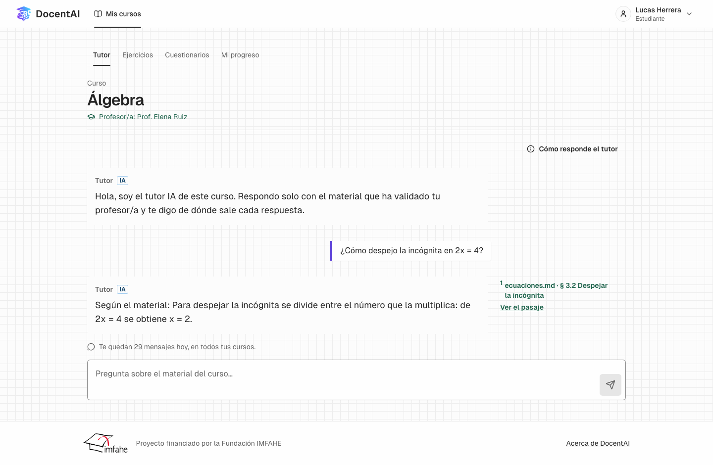

<p align="center">
  
</p>

<p align="center">
  <a href="https://github.com/DocentAI-Org/backend/actions/workflows/ci.yml"></a>
  <a href="LICENSE"></a>
</p>

# DocentAI Backend

DocentAI is a teacher-guided AI tutor. The teacher uploads and validates the course material; the
tutor answers students **only** from that material, cites the document and section of every answer,
and says plainly when the material does not cover a question. Beyond answering, it gives feedback
on worked exercises, notices recurring mistakes, adapts quizzes to each student, and shows the
teacher where the class is struggling. It works for any subject, from secondary-school maths to
university courses.

This repository is the FastAPI service behind it. The web app is
[`DocentAI-Org/frontend`](https://github.com/DocentAI-Org/frontend).

<picture>
  <source media="(prefers-color-scheme: dark)" srcset="docs/images/student-chat-dark.png">
  
</picture>

- **Contract**: [`openapi.json`](openapi.json) (committed; the frontend generates its types from
  it). Interactive docs at `http://localhost:8000/docs`.
- **Rules**: [`AGENTS.md`](AGENTS.md), for people and coding agents alike; conventions in
  [`CONTRIBUTING.md`](CONTRIBUTING.md).

## How it works

1. A teacher creates a course and uploads PDF, DOCX or Markdown material. The backend splits it
   into fragments, embeds them (pgvector) and lets the teacher review, include or exclude each
   document.
2. A student asks a question. The backend retrieves the closest validated fragments; if none is
   close enough, the answer says the material does not cover it, with no citations. Otherwise
   the model answers from those fragments only, and every answer carries its sources.
3. The teacher's settings (level, tone, solution policy: direct, hints first, or hints only) shape
   every prompt. Exercise feedback classifies each mistake, and repeated mistakes feed the
   teacher dashboard, the adaptive quizzes and the student's next steps.

## Stack

Python + FastAPI, SQLAlchemy over Supabase Postgres + pgvector, Supabase Auth and Storage, and
one LLM entry point (`app/llm/`) with three providers: Ollama locally, OpenAI or any
OpenAI-compatible API, and Anthropic. The provider and model are chosen per task through `.env`.

## Local development

Prerequisites: Docker, Node.js (for `npx supabase`), `uv`, and Ollama with the default models:

```bash
ollama pull qwen2.5:7b
ollama pull bge-m3
```

Then:

```bash
uv sync
npx supabase start                 # Postgres + pgvector, Auth, Storage; applies migrations
cp .env.example .env               # fill SUPABASE_SERVICE_ROLE_KEY and SUPABASE_JWT_SECRET
npx supabase status -o env         # ...from SERVICE_ROLE_KEY and JWT_SECRET here
uv run uvicorn app.main:app --reload
uv run python scripts/seed_dev.py  # sample data (needs Ollama) + demo access tokens
```

The seed creates four teachers, three class groups (25–30 students each), twelve courses of
several subjects with their material, topics and question bank, and about eight weeks of
student activity dated relative to now, from `scripts/seed_data/` (shared with the frontend's
demo). It signs in as `admin@docentai.local`, `profesora@docentai.local` (Prof. Elena Ruiz) and
`alumno@docentai.local` (Lucas Herrera, at risk in Álgebra); every sample account shares the
password in `scripts/seed_dev.py`. Running it again only prints the tokens;
`--reset` deletes the sample courses and builds them again.

## Checks (same as CI)

```bash
uv run ruff check . && uv run ruff format --check .
uv run pyright
uv run python scripts/export_openapi.py --check   # regenerate without --check after API changes
uv run pytest --cov                               # needs `npx supabase db start`; min. 95 %
uv run pytest -m "not db"                         # unit tests only, no database
```

Tests never call a model provider: they use a deterministic fake (`tests/fakes.py`).

## Layout

| Path | What |
|---|---|
| `app/routers/{admin,teacher,student}` | role-scoped `/v1` routes |
| `app/services/` | business logic (courses, material, retrieval, tutor, allowance…) |
| `app/llm/` | the only place that talks to a model provider |
| `app/prompts/es/` | tutor prompts and fixed texts, outside code |
| `supabase/migrations/` | the database schema, RLS and storage bucket |
| `scripts/` | OpenAPI export/check, local seed and its data (`seed_data/`) |

## Changing the model provider

Edit `.env` only (specs/014). A default provider and model, and optionally one per task
(`TUTOR`, `FEEDBACK`, `REVIEW`, `QUESTIONS`), e.g. a cheap model for the chat and a stronger
one for exercise feedback, with embeddings kept on local Ollama:

```env
LLM_PROVIDER=anthropic
LLM_MODEL=claude-haiku-5-5
ANTHROPIC_API_KEY=…
LLM_FEEDBACK_MODEL=claude-sonnet-5-5
LLM_FEEDBACK_EFFORT=low
LLM_EMBEDDING_PROVIDER=ollama
```

Any OpenAI-compatible API (OpenAI, Mistral, vLLM…) is `openai` with its `OPENAI_BASE_URL`.
Anthropic takes no temperature (`LLM_FEEDBACK_TEMPERATURE` only applies to the others) and
has no embeddings. Costs in the interaction log use `LLM_PRICES` per model (current Claude
models are built in).

Embeddings must stay 1024-dimensional (`EMBEDDING_DIMENSIONS`); a different size needs a
migration and re-processing the material. Re-tune `RETRIEVAL_MIN_SIMILARITY` and
`RETRIEVAL_MIN_SIMILARITY_EXERCISES` for a new embedding model.

## Use of Generative AI

DocentAI is developed with AI coding agents, mostly Claude, under the guidance of the team. The
specifications, agent configuration and evaluation tools live in a separate repository and evolve
with the project; they are not a validated methodology for agentic software development.

Every change goes through AI code review and the checks above: linting, type checking, the
OpenAPI contract check and tests with a minimum of 95 % coverage, plus CodeQL on every pull
request. Even so, the code may contain the usual issues of AI-generated code, and bugs that will
be fixed as they are found.

## Disclaimer

DocentAI is a research prototype under development, not a commercial product. It is provided
"as is", without warranty of any kind, as stated in its [license](LICENSE). Its answers come from a
language model and can be wrong even when they cite the material; teachers remain responsible
for the material they validate and for how the tutor is used in their courses. Never load real
student data into a development or test environment.

## Acknowledgements

<a href="https://imfahe.org"></a>

DocentAI is funded by the [IMFAHE Foundation](https://imfahe.org) (International Mentoring
Foundation for the Advancement of Higher Education) through the IMFAHE Global Idea Competition –
Shark Tank 2026. *Proyecto financiado por la Fundación IMFAHE.*

DocentAI runs on open models and open-source software, among them [Ollama](https://ollama.com),
[Qwen](https://github.com/QwenLM), [BGE-M3](https://huggingface.co/BAAI/bge-m3),
[Supabase](https://supabase.com), [pgvector](https://github.com/pgvector/pgvector) and
[FastAPI](https://fastapi.tiangolo.com). We thank everyone who builds and maintains them.

## Team

| Member | Area |
|---|---|
| Miguel Romero | Product and development |
| Denisa-Andreea Constantinescu | Infrastructure and security |
| Génesis M. De León | Pedagogy |
| Laura M. Ezama | Study design and ethics |
| Mariano Soler | Finance and sustainability |

## License

Apache License, Version 2.0. See [LICENSE](LICENSE) and [NOTICE](NOTICE). The IMFAHE logo is a
trademark of the IMFAHE Foundation and is not covered by this license.
